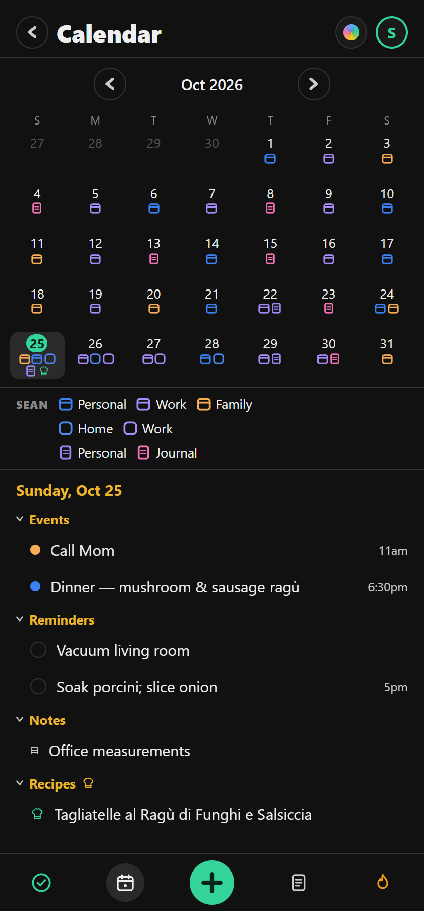
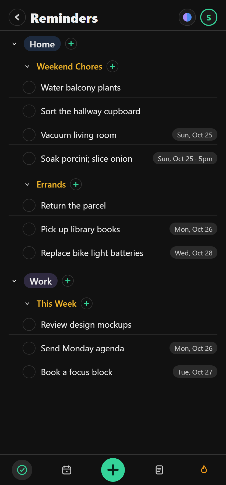
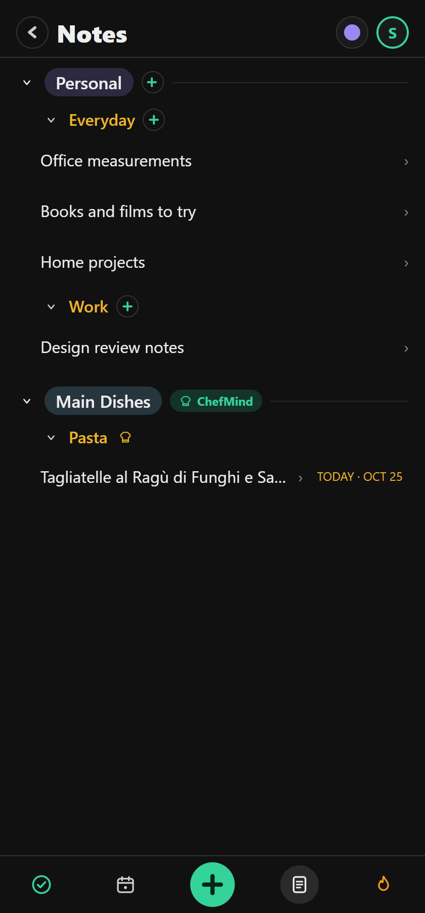
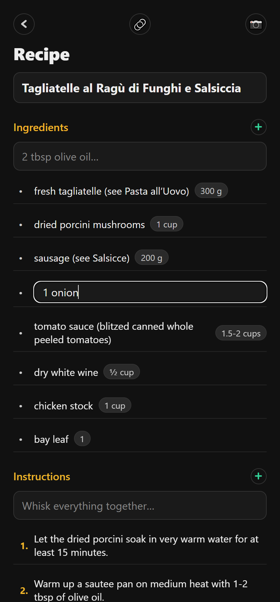

# CalMind

Reminders, calendar, notes and habits in one local-first app.

## Disclaimer

I haven't been quite happy with subtle things like not being able to have reminders from previous days on the calendar not continue to show until they are checked off.. I also wanted to tie together reminders, notes, and my calendar.. I also like enforcing date and time patterns.

Feel free to deploy this on your own website, build and deploy the iOS version, etc.

**This is a personal project to have some fun with claude code, which generated essentially all of the code, and the rest of this readme:**

## Quick start / Install

- Web: <https://seancheren.com/calmind/>.
- macOS, Windows and Linux: installers on [GitHub Releases](https://github.com/chere005/CalMind/releases). Unsigned.
- iOS, Android and Apple Watch: build from source, see Building.

## Platforms

- Web
- iOS and Android
- Apple Watch (app and complication) and an iPhone home-screen widget
- macOS, Windows and Linux (Tauri desktop app)

## Usage

### Calendar

Calendars, reminders, notes and ChefMind recipes in one month view. Unfinished reminders carry forward until checked off.

Use the calendar picker → **Manage calendars…** → **Import read-only calendars**:

- **Google:** paste the calendar's **Secret address in iCal format** from Google Calendar settings → your calendar → **Integrate calendar**. Public iCal links work too. Some work or school accounts hide the secret address; their administrator controls its availability. See [Google's view-only setup](https://support.google.com/calendar/answer/37648?hl=en).
- **CalDAV:** enter the HTTPS server or calendar URL, username and password (an app password if your provider requires one), then choose calendars to import. Each selected calendar creates its own new read-only calendar folder. If the provider redirects to a different host, use its direct calendar-home or collection URL.
- **Calendar link:** paste another provider's `.ics` or `webcal://` link.

Imports create separate calendar folders and leave your existing folders intact. Imported events refresh on foreground or every twenty minutes, with a cached copy for offline use. Rename, recolor, hide or remove the connection here; edit events in the original calendar. Google uses its iCal feed, so no Google Cloud project or OAuth setup is needed. CalDAV requires the server's cURL and DOM XML extensions. Connection details sync with your account and are encrypted at rest on the server, like the rest of the snapshot; local app storage contains the connection details.

<picture></picture>

### Reminders

Home, errands and work to-dos, dated or not.

<picture></picture>

### Notes

Reference notes and recipes, in folders.

<picture></picture>

### Recipe editor

Ingredients, quantities and steps. Recipes can be imported from a photo or a URL.

<picture></picture>

## Notes

- Five tabs: Reminders · Calendar · Add · Notes · Habits.
- Local-first: each client holds the whole store; a small PHP server syncs.
- One TypeScript core (`packages/core`) shared by every platform.
- Also: search, sharing, a public request page, four themes.

## Building

```sh
npm install
php -S 127.0.0.1:8788 -t server/public   # the API
npm run web                              # the app on :8081
npm test
```

Phones: `cd apps/app && npx expo start`, then `i` or `a`. `EXPO_PUBLIC_API_URL` points a build at another server. Deploy needs `server/deploy.conf` (copy the sample). Release: `npm run dtp` (or `tdtp`, tests first); the tag builds the desktop installers on GitHub.

## Documentation

- [ARCHITECTURE.md](ARCHITECTURE.md): the tree, each platform, sync, environments, release lane.
- [docs/api.md](docs/api.md): the API.
- [TESTING.md](TESTING.md), [PARITY.md](PARITY.md), [TODO.md](TODO.md).
- [AGENTS.md](AGENTS.md): rules for anyone, human or agent, changing the code.

## Contributing

Issues and pull requests are welcome. Read AGENTS.md first; `npm test` must pass. BSD 3-Clause, see [LICENSE](LICENSE).
